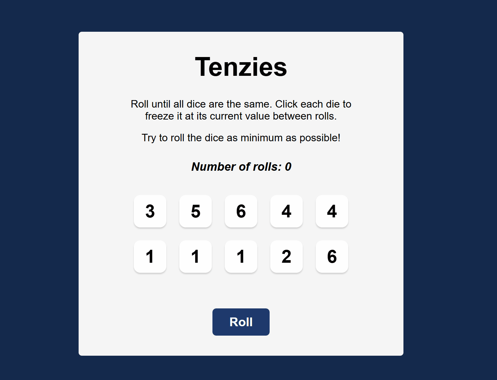

# 🎲 Tenzies

An interactive dice game built with React. The goal is to get all ten dice to show the same number in as few rolls as possible.

Players can hold individual dice to preserve their values between rolls. Once all dice match, the game celebrates the victory and allows the player to start a new round.

🔗 **[View Live Demo](YOUR_DEPLOYED_URL_HERE)**

---

## 📸 Preview

<p align="center">
  
</p>

---

## ✨ Features

- Roll ten dice with randomly generated values.
- Hold and release individual dice between rolls.
- Keep held dice unchanged while rerolling the others.
- Track the number of rolls during each game.
- Automatically detect when all dice have the same value and are held.
- Display a confetti animation when the player wins.
- Start a new game with a fresh set of dice and a reset roll counter.
- Improve accessibility with screen reader announcements and automatic button focus after winning.

---

## 🛠️ Built With

- React
- JavaScript
- HTML5
- CSS3
- Vite
- nanoid — for generating unique dice IDs.
- react-confetti — for the victory animation.

---

## 📚 What I Learned

During this project I practiced:

- Managing component state using the `useState` hook.
- Updating arrays of objects immutably with `.map()` and the spread operator.
- Using functional state updates based on previous state.
- Handling user interactions and dynamically updating the UI.
- Deriving values from state to determine when the game has been won.
- Using `useRef` to access DOM elements and manage keyboard focus.
- Conditionally rendering components and updating button labels.
- Generating unique IDs for dynamically rendered components.
- Improving accessibility with ARIA live regions and focus management.

---

## 🔮 Future Improvements

- Save the player's best score using Local Storage.
- Add a timer to track how quickly a game is completed.
- Add a leaderboard or personal statistics.
- Improve the interface for smaller screens.

---

## 🚀 Getting Started

Clone the repository:

```bash
git clone https://github.com/incarasa/Tenzies-Game
```

Navigate into the project directory:

```bash
cd tenzies
```

Install the dependencies:

```bash
npm install
```

Start the development server:

```bash
npm start
```

*If the project uses the standard Vite scripts, run `npm run dev` instead.*